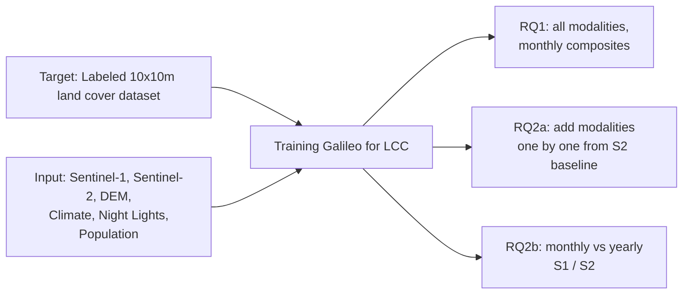

# A Solid Foundation? Geospatial Foundation Models for Land Cover Mapping in Africa

MGI master thesis, Tomer Peled, Wageningen University & Research (GRS).
Supervisors: Dainius Masiliunas, Nandika Tsendbazar.
Full proposal: [thesis-proposal.pdf](reports/proposal/LateX/thesis-proposal.pdf).

## The project
This thesis fine-tunes the GFM [Galileo](https://github.com/nasaharvest/galileo) for land cover classification in Africa and asks:

1. How does Galileo's accuracy in Africa compare to existing land cover maps?
2. How much do (a) extra input modalities and (b) monthly instead of yearly Sentinel-1/2 composites improve that accuracy?

**Data.** Training labels come from the Geo-Wiki 2015 reference dataset
(Lesiv et al., 2025): 44,644 African sites of 100 × 100 m with every 10 × 10 m cell
labelled (bare, crops, herbaceous, shrubs, trees, built-up, water). Testing uses the
independent WorldCover validation set (3,599 African sites). Inputs mirror Galileo's
pretraining: Sentinel-1, Sentinel-2 + NDVI, SRTM DEM, ERA5, TerraClimate, VIIRS,
LandScan and coordinates, downloaded from Google Earth Engine for 2015–2016.

**Method.**



## Project structure

```text
data/            raw/ & external/ (unchanged sources), interim/, processed/  — not in Git
notebooks/       numbered notebooks (see notebooks/README.md)
  geowiki/                           0.02 download, 0.03 exploration of Geo-Wiki 2015
  downloading_preprocessing_input/   0.04–0.06 Sentinel-1, Sentinel-2, SRTM for a test site
src/tomer_peled_mgi_thesis/          reusable code: config (paths, .env), run logging
runs/            generated tables, figures, executed notebooks, logs  — not in Git
reports/         proposal LaTeX source, figures and bibliography
tests/           pytest tests
guides/          working rules for agents (see AGENTS.md)
```

## How to run

Install [Pixi](https://pixi.prefix.dev/), then from the project root:

```bash
pixi install --locked
```

```bash
pixi run --locked notebook
```

Earth Engine notebooks (0.04–0.06) need a Cloud project id: copy `.env.example` to
`.env`, set `EE_PROJECT`, and run `pixi run earthengine authenticate` once.
Each notebook can also run headless; the executed copy goes to `runs/notebooks/`:

| Task | Notebook |
| --- | --- |
| `pixi run --locked check-geowiki-download` | 0.02 — fetch Geo-Wiki 2015 (~2 GB) and Natural Earth boundaries |
| `pixi run --locked check-geowiki-exploration` | 0.03 — site coverage and class balance for Africa |
| `pixi run --locked check-test-site-sentinel1` | 0.04 — Sentinel-1 monthly composites, one site |
| `pixi run --locked check-test-site-sentinel2` | 0.05 — Sentinel-2 + NDVI monthly composites, one site |
| `pixi run --locked check-test-site-srtm` | 0.06 — SRTM elevation and slope, one site |
| `pixi run --locked test` | pytest suite |
