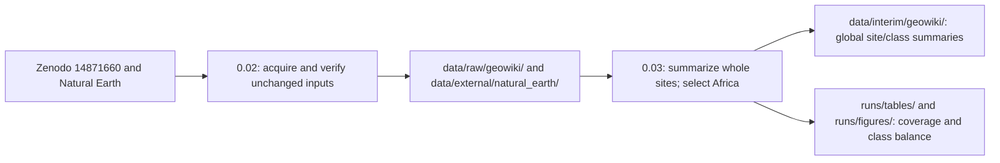

# Tomer Peled MGI Thesis

Land Cover Classification in Africa using multi-temporal and multi-modal Geospatial Foundation Model

Author: Tomer Peled. Generated from personal data science template
**0.1.0**, inspired by Cookiecutter Data Science.

## Setup and commands

Install [Pixi](https://pixi.prefix.dev/), then run from this project directory:

```text
pixi install
pixi run notebook
```

The first install resolves dependencies, creates `pixi.lock`, and installs
`tomer_peled_mgi_thesis` editable from `src/`. Keep the lockfile for the user
to commit. Subsequent reproduction uses `pixi install --locked` and
`pixi run --locked notebook`. Record the installed `pixi --version` below.

Open `notebooks/0.01-tp-getting-started.ipynb` and run all
cells. For a noninteractive execution of that same setup demonstration:

```text
pixi run --locked check-notebook
```

Its executed copy is written to `runs/notebooks/`. Keep authored notebooks in `notebooks/`;
the executed copy is a generated verification artifact. Geo-Wiki execution tasks are described below.

Run the included pytest examples with `pixi run --locked test`. Read
[testing guidance](guides/testing.md) before adding tests and
[run reporting](guides/run-reporting.md) before recording substantial runs.

## Project context — fill in as decisions become known

- Question and intended deliverable: Initial Geo-Wiki 2015 coverage and African class-balance exploration; broader thesis analysis TBD.
- Input sources, access/download instructions, licenses: Zenodo 14871660 (CC BY 4.0) and Natural Earth (public domain); see the acquisition notebook and linked source notes below.
- Area/date range, principal analytical CRS and rationale (spatial work only): Global 2015 reference data, with Africa selected by mean site centre; WGS84 for membership and display, with no distance/area calculations.
- Processing stages and canonical output paths: Unchanged CSV in `data/raw/`; cached site summaries in `data/interim/`; descriptive tables and figures in `runs/`. No final analysis-ready dataset is declared yet.
- Key assumptions and decisions: Retain all classes and African sites; balance counts annotation rows rather than continental area or reconstructed unique raster cells.
- Current work / next step / unresolved blockers: Both Geo-Wiki notebooks execute on the full source. Assess pixel uniqueness, label quality, and sampling before downstream modeling.
- Pixi version used: 0.81.0

## Geo-Wiki 2015 exploration

The [download notebook](notebooks/geowiki/0.02-tp-geowiki-2015-download.ipynb)
acquires or verifies the complete [Zenodo 14871660 release](https://zenodo.org/records/14871660)
and Natural Earth country boundaries. The [exploration notebook](notebooks/geowiki/0.03-tp-geowiki-2015-exploration.ipynb)
aggregates complete sites across CSV chunks, inspects site sizes and coverage,
selects all African sites, and compares annotation pixel share with site presence.
No class filtering or raster export is applied. WGS84 coordinates are used for
continent membership and display; no distances or areas are measured.

```text
pixi install --locked
pixi run --locked check-geowiki-download
pixi run --locked check-geowiki-exploration
```

First acquisition needs internet and about 2 GB for the CSV. Offline reruns use
the saved public metadata and inputs. The exploration caches small global summaries
under `data/interim/geowiki/14871660/`; set `REBUILD_SUMMARY=True` in the notebook
to rescan the original. Tables go to `runs/tables/geowiki/14871660/`, figures to
`runs/figures/geowiki/14871660/`, and executed notebooks to `runs/notebooks/`.
Authored notebooks remain under `notebooks/`. Read the [CSV source notes](data/raw/geowiki/14871660/README.md)
and [boundary notes](data/external/natural_earth/README.md) for provenance and limitations.

## Pipeline overview

The starter verifies setup; the Geo-Wiki notebooks implement acquisition and exploration.



| Input | Processing / entry point | Output |
| --- | --- | --- |
| Synthetic values 1, 2, 3 | [Getting started](notebooks/0.01-tp-getting-started.ipynb) | Table and mean in notebook; `runs/getting-started.log` |
| Authored starter notebook | `pixi run --locked check-notebook` | Executed copy in `runs/notebooks/` |
| Zenodo record and country boundary | `pixi run --locked check-geowiki-download` | Verified unchanged inputs; executed notebook in `runs/notebooks/` |
| Full Geo-Wiki CSV and boundary | `pixi run --locked check-geowiki-exploration` | Site summaries in `data/interim/`; coverage and balance tables/figures in `runs/` |

Use [the notebook index](notebooks/README.md) for purpose, prerequisites, and reading
order. Infrastructure modules: [paths](src/tomer_peled_mgi_thesis/config.py)
and [run logging](src/tomer_peled_mgi_thesis/run_logging.py). Add links to
analytical modules and real inputs/outputs as they are implemented.

## Layout

`data/raw/` and `data/external/` hold unchanged sources; `data/interim/` holds useful
checkpoints; `data/processed/` holds canonical results. Add source notes alongside
inputs. Data are ignored by Git, so document retrieval or authorized storage access.

`notebooks/` contains exploration and demonstrations. `src/tomer_peled_mgi_thesis/`
contains installed reusable code: project paths, explicit output directory creation,
and a standard-library `log_run()` context manager. `guides/` contains
task-specific working instructions, routed by [AGENTS.md](AGENTS.md).

```text
tests/
  unit/                 # Small behavior/regression tests, including logging examples
  integration/          # Connected-stage tests when needed
  fixtures/             # Tiny non-sensitive test inputs
reports/                # Authored LaTeX sources, bibliography, and writing assets
runs/
  figures/              # Generated plots/maps
  tables/               # Summary tables
  notebooks/            # Generated notebook copies/exports
  *.log                 # Useful logs; optional run notes or per-run subdirectories
references/
  data_dictionaries/    # Schemas, field/band meanings, units
  sources/              # Source and methodological references
qgis/
  *.qlr                 # Styled vector/raster definitions referencing ../data/
  projects/             # Inspection projects using relative data paths
```

Generated run artifacts are ignored by Git; authored reports, references and QGIS assets are versioned
after checking size, licensing, and sensitivity. PyQGIS remains optional.
Add `models/` or `configs/` when needed.
Agents leave changes uncommitted for review. Update this README with real commands
and decisions as the project develops; avoid separate competing status documents.

## Shared guides

At task start, follow the hosted-first instructions in [AGENTS.md](AGENTS.md): read
shared working rules and relevant topic guides from GitHub, using the local `guides/`
backup when the URL is unconfigured or the hosted guides cannot be read. Report when
using the backup; it reflects the template used to generate this project.

Hosted guide directory: https://raw.githubusercontent.com/TomerP2/Cookiecutter-Geospatial-Data-Science-Template/main/templates/shared-guides

To change the guide source, update its directory URL in AGENTS.md and here.
Reading remote guidance does not update local files. Keep
project-specific rules in AGENTS.md; user instructions and local overrides take
precedence over shared guides.
